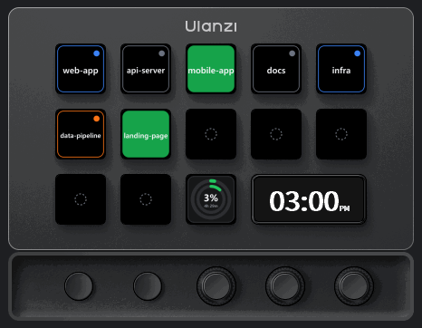
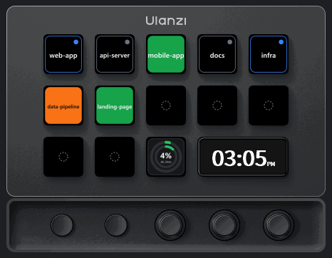

# clanzi

Ulanzi D200X의 키를 Claude Code 대시보드로 만드는 Ulanzi Studio 플러그인입니다. 열려 있는 Claude Code 세션마다 키 하나에 상태를 보여 주고, 키를 누르면 그 세션의 창으로 이동합니다. 5시간·주간 사용 한도도 키 하나에 표시합니다.

CLI(Windows Terminal, IDE 터미널 등), VS Code 확장 패널, Desktop 앱에서 실행한 세션을 모두 표시합니다.



*Ulanzi Studio 화면을 예시 세션으로 녹화했습니다. 위 두 줄과 아래 왼쪽 두 키가 세션 슬롯, 아래 가운데가 사용량 키입니다. 오른쪽 2x 키(시계)는 Studio 기본 기능입니다.*

## 기능

### 세션 슬롯

'세션 슬롯' 액션을 놓은 키마다 세션 하나를 표시합니다. 세션은 연 순서대로 키 번호가 낮은 자리부터 채워지고, 플러그인이나 Studio를 재시작해도 원래 자리로 돌아옵니다.

키에는 작업 폴더 이름과 Claude가 붙인 짧은 대화 제목이 표시됩니다. 같은 폴더 이름이 겹치면 뒤에 " 2"를 붙여 구분합니다.

| 상태 | 표시 |
| --- | --- |
| 빈 슬롯 | 점선 원 |
| 대기 | 회색 테두리·점 |
| 작업 중 | 파란 테두리, 파란 점 깜빡임 |
| 입력 대기 (권한 확인, 질문) | 주황 배경 깜빡임, 주황 점 |
| 완료 | 초록 배경 |
| 오류 | 빨간 테두리·점 |

**누르기:** 그 세션의 창으로 이동하고, 완료·오류 표시를 확인 처리해 대기로 바꿉니다. 확인 처리는 플러그인을 재시작해도 유지되고, 다음 턴이 끝나면 다시 표시됩니다.

| 세션 위치 | 이동 방식 |
| --- | --- |
| VS Code 확장 패널 | 그 폴더의 VS Code 창을 앞으로 가져오고 해당 대화를 엽니다 |
| 터미널 CLI | Claude를 실행한 터미널·IDE 창을 앞으로 가져옵니다 (탭까지는 고르지 못합니다) |

**2초 누르고 있기:** 아래에서 빨간색이 차오르고, 다 차면 그 세션의 Claude Code 프로세스를 강제 종료합니다. 대상 프로세스가 `claude`일 때만 종료합니다.



### 사용량

바깥 링은 5시간 한도, 안쪽 링은 주간 한도의 사용률입니다. 가운데 숫자는 5시간 한도 사용률, 그 아래는 초기화까지 남은 시간입니다. 70% 미만은 초록, 90% 미만은 노랑, 그 이상은 빨강으로 표시합니다. 값은 Claude Code의 `/usage`와 같습니다(구독 플랜에서만 표시).

**누르기:** 기본 브라우저로 claude.ai 사용량 화면을 엽니다.

### 세션 페이지 (노브)

세션이 세션 슬롯 키보다 많을 때 노브를 돌려 다음 페이지의 세션을 봅니다. 노브를 누르면 첫 페이지로 돌아가고, 30초 동안 손대지 않아도 첫 페이지로 돌아갑니다.

## 동작 방식

```
Claude Code 세션 (CLI · VS Code 패널 · Desktop)
  └ clanzi mod (Claude Code 플러그인)
        │ http://127.0.0.1:39311 (이 PC 안에서만)
        ▼
Ulanzi Studio 플러그인 → D200X 키
```

Claude Code에 설치하는 clanzi mod가 세션 상태를 Studio 플러그인으로 보냅니다. Studio가 꺼져 있으면 보내지 않고 조용히 넘어가며, Claude Code 화면에 오류도 남기지 않습니다.

mod가 보내는 것은 세션 ID, 작업 폴더, 상태, 턴 번호, 사용량, 실행 위치, 프로세스 ID뿐입니다. 프롬프트·명령·응답 내용은 보내지 않습니다. 대화 제목은 플러그인이 이 PC의 대화 기록 파일에서 제목 항목만 읽어 씁니다.

## 요구 사항

- Windows 10 또는 11
- Ulanzi Studio와 Ulanzi D200X (Studio 3.4.8에서 확인)
- Claude Code 2.1.287 이상
- Node.js 22.18 이상과 npm (설치 스크립트 실행용)
- .NET Framework 4 (Windows 10·11에 기본으로 들어 있음. 창 전환 도우미를 빌드할 때 씁니다)

## 설치

```sh
git clone https://github.com/whatef-labs/clanzi.git
cd clanzi
npm install
npm run clanzi:install
```

설치 스크립트가 하는 일:

1. 플러그인을 빌드합니다.
2. Studio 플러그인 폴더(`%APPDATA%\Ulanzi\UlanziDeck\Plugins\com.ulanzi.clanzi.ulanziPlugin`)에 복사합니다.
3. `~/.claude/settings.json`을 백업(`settings.json.clanzi-bak-<시각>`)한 뒤 Claude Code에 clanzi mod를 설치합니다.

settings.json에는 `extraKnownMarketplaces.clanzi-local`과 `enabledPlugins["clanzi@clanzi-local"]` 두 항목만 추가되고, 기존 훅이나 statusLine은 건드리지 않습니다. settings.json을 바꾸기 전에 할 일을 보여 주고 확인을 받습니다.

- `npm run clanzi:install -- --dry-run`: 실제로 바꾸지 않고 할 일만 보여 줍니다.
- `npm run clanzi:install -- --yes`: 확인 없이 진행합니다.

설치한 뒤:

1. Ulanzi Studio를 재시작합니다.
2. Studio 액션 목록의 Clanzi에서 '세션 슬롯'을 원하는 키에, '사용량'을 키 하나에, '세션 페이지'를 노브에 놓습니다. Studio 프로파일은 설치 스크립트가 바꾸지 않습니다.
3. 이미 열려 있는 Claude Code 세션에서는 `/reload-plugins`를 실행합니다. 새로 여는 세션에는 바로 적용됩니다.

Claude Code mod는 clone한 폴더를 로컬 마켓플레이스로 등록해 설치합니다. 업데이트와 제거에 이 폴더를 쓰므로 지우거나 옮기지 마세요.

### 상태 확인

```sh
npm run clanzi:status
```

Studio 플러그인과 mod의 설치 상태, Studio 플러그인이 실행 중인지 보여 줍니다.

### 업데이트

```sh
git pull
npm install
npm run clanzi:install
```

Studio를 재시작하고, 열려 있는 Claude Code 세션에서 `/reload-plugins`를 실행합니다. Studio가 켜져 있는 상태에서 설치해도 됩니다.

### 제거

```sh
npm run clanzi:uninstall
```

settings.json을 백업한 뒤 mod와 마켓플레이스(settings.json의 두 항목 포함)를 제거하고, 실행 중인 Studio 플러그인을 끄고 폴더를 지웁니다. Studio를 재시작하면 목록에서 사라집니다.

## 참고

- **VS Code에서 "Allow 'Claude Code for VS Code' extension to open this URI?"가 뜰 때:** VS Code는 바깥에서 들어온 확장 주소를 열기 전에 확인을 받습니다. "Do not ask me again for this extension"을 체크하고 Open을 누르면 다음부터 묻지 않습니다. 되돌리려면 명령 팔레트에서 "Extensions: Manage Authorized Extension URIs..."를 실행합니다. 체크하면 다른 앱이나 웹 링크가 연 이 확장의 주소(Claude 탭 열기, 플러그인 설치 창 열기)도 묻지 않습니다.
- **D200X의 2x 키:** Studio 전용 "스몰 윈도우" 키라 플러그인 액션을 놓을 수 없습니다.
- **세션이 늦게 나타날 때:** 새 세션은 열린 뒤 약 1.5초 뒤에 표시됩니다. VS Code가 내부적으로 잠깐 띄웠다 닫는 세션을 거르기 위해서입니다.
- **창을 닫아 강제로 끝낸 세션:** 종료 신호를 보내지 못해 약 70초 뒤에 키에서 사라집니다.

## 포함한 외부 코드

`src/vendor/ulanzi-api/`에 Ulanzi Studio 공식 Node SDK(Apache-2.0)를 수정 없이 포함합니다. 라이선스는 같은 폴더의 `LICENSE`에 있습니다.
